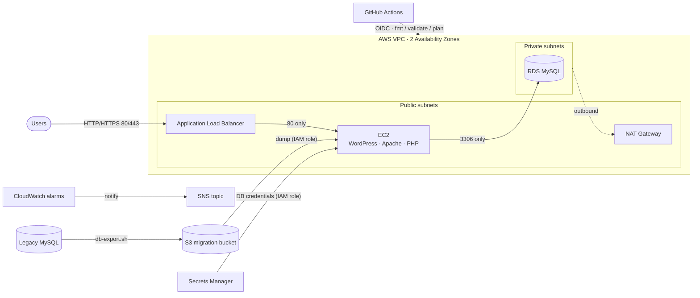

# WordPress + MySQL Migration to AWS

A hands-on cloud engineering project: rebuilding a legacy WordPress site and its MySQL database on AWS, using Terraform for infrastructure and Ansible for configuration management.

## Architecture



- **VPC** with public and private subnets across 2 AZs
- **EC2** (WordPress/Apache/PHP) in a public subnet, behind an **Application Load Balancer**
- **RDS MySQL** in private subnets, reachable only from the EC2 security group
- **NAT Gateway** for outbound internet access from private subnets
- **S3** bucket as the transfer point for the database dump
- **Secrets Manager** holds auto-generated DB credentials; nothing sensitive lives in tfvars
- **IAM role** on EC2, scoped to read only the S3 dump and the DB secret
- **CloudWatch alarms** (EC2 CPU, RDS free storage) notifying an **SNS** topic
- **GitHub Actions** runs `terraform fmt`, `validate` and `plan` on every PR, authenticating via OIDC

Security groups are chained: internet → ALB (80/443) → EC2 (80 only) → RDS (3306 only). SSH is restricted to a single admin CIDR.

## Repo structure

```
terraform/
  modules/            vpc, security-groups, s3, iam, rds, ec2, secrets, monitoring
  environments/dev/   root config wiring the modules together
ansible/
  inventory/          dynamic AWS EC2 inventory (aws_ec2.yml)
  roles/              common, apache, php, mysql_client, wordpress
  playbook.yml
migration/
  db-export.sh        run on the legacy server; uploads the dump to S3
  db-import.sh        manual S3 → RDS import (Ansible does this automatically)
.github/workflows/
  terraform-plan.yml  fmt / validate / plan on every PR touching terraform/
```

## Prerequisites

- Terraform >= 1.5
- AWS CLI v2 with credentials that can create VPC, EC2, RDS, IAM, S3, Secrets Manager, CloudWatch and SNS resources
- Ansible + the `amazon.aws` collection + `boto3`/`botocore`
- An existing EC2 key pair in your target region

## Setup

1. **Bootstrap remote state** (one-time): create an S3 bucket and DynamoDB table, then set their names in `terraform/environments/dev/backend.tf`.
2. **Configure variables:**
   ```bash
   cd terraform/environments/dev
   cp terraform.tfvars.example terraform.tfvars   # set admin_cidr, migration_bucket_name, key_name, optional alarm_email
   ```
3. **Provision:** `terraform init && terraform plan && terraform apply`
4. **Export the legacy DB to S3:**
   ```bash
   cd ../../../migration
   DB_NAME=wordpress DB_USER=<user> MIGRATION_BUCKET=<bucket> ./db-export.sh
   ```
5. **Deploy WordPress and import the DB:**
   ```bash
   cd ..
   MIGRATION_BUCKET=<bucket> ansible-playbook -i ansible/inventory/aws_ec2.yml ansible/playbook.yml \
     --private-key ~/.ssh/<key>.pem -u ubuntu \
     -e db_secret_id=$(terraform -chdir=terraform/environments/dev output -raw db_secret_id)
   ```
6. Open the ALB DNS name from the Terraform output to confirm the site is live.

## Cleanup

```bash
cd terraform/environments/dev && terraform destroy
```

Tears down the VPC/EC2/RDS/ALB stack. The state bucket and lock table are kept for reuse.

## Notes

- DB credentials are generated with `random_password` and stored only in Secrets Manager — never in tfvars or Git.
- `terraform.tfvars` and `.sql` dumps are gitignored; only `.tfvars.example` is tracked.
- CI uses OIDC role assumption, not stored AWS access keys.

## Lessons learned

- `mysqldump` fails against `caching_sha2_password`; `mysql_native_password` fixed it.
- Generated passwords with characters like `(` break inline shell commands — pass them via `MYSQL_PWD`.
- The AWS CLI on EC2 does not infer the region; set `--region` or an Ansible default.
- Apache's default `index.html` shadows WordPress's `index.php` — remove it in the role.
- GitHub Actions OIDC needs both the role ARN and `permissions: id-token: write`.
- Since AWS provider v5, `aws_db_instance.id` is the resource ID, not the DB name — CloudWatch dimensions need `.identifier`.